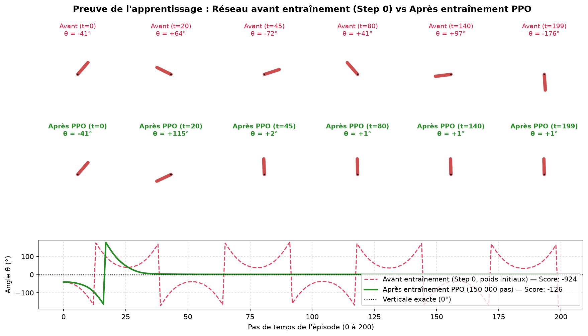
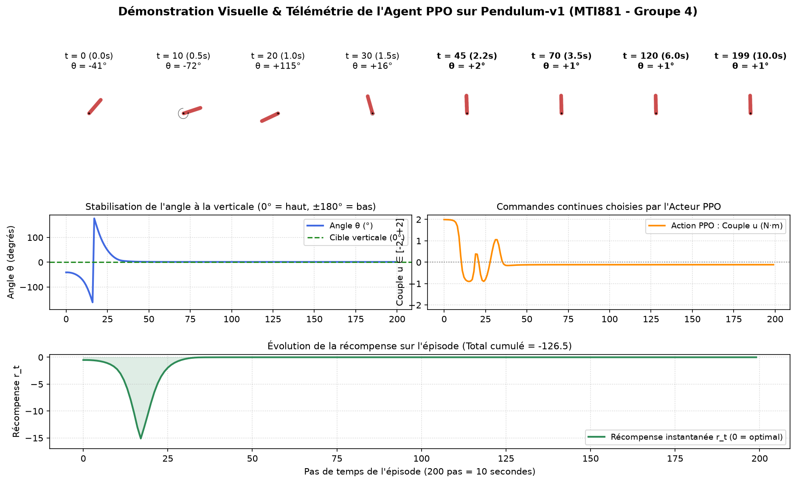
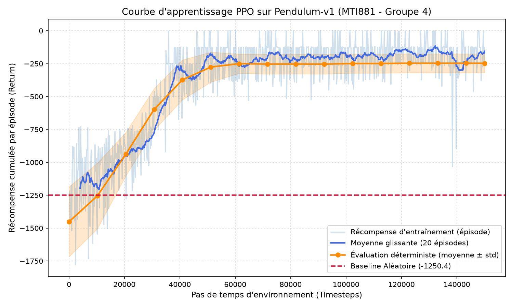

# Guide Complet & Résultats : PPO sur `Pendulum-v1` vers `TMRL` (MTI881 - Groupe 4)

> **Astuce VS Code** : Appuyez sur `Ctrl+Shift+V` (ou clic droit $\rightarrow$ *Open Preview*) dans VS Code pour voir ce document avec les formules mathématiques, les schémas et les images intégrées.

---

## Partie 1 : Réponses à vos questions & Visuels

### 1. Comment savoir que ce sont bien nos entraînements qui font cela ?
Dans `Gymnasium`, l'environnement `Pendulum-v1` est un pur simulateur physique ($\ddot{\theta} = \frac{3g}{2l}\sin\theta + \frac{3}{ml^2}u$). Il ne contient **aucun contrôleur** : il reçoit un couple moteur $u \in [-2, +2]$ et applique les lois de Newton.

Pour prouver que tout vient de votre entraînement PyTorch :
1. **À l'étape 0 (avant entraînement)**, les poids de votre réseau [`ContinuousActor`](src/networks.py) sont initialisés aléatoirement (`orthogonal_init`). Si on lance cet agent neuf sur le pendule, il ne sait pas prendre d'élan : la tige tombe en bas ($\theta \approx \pm 180^\circ$) et oscille mollement avec un score de **$\approx -1300$**.
2. **Pendant l'entraînement (`train_ppo.py`)**, l'algorithme PPO modifie les poids des matrices `Linear` dans PyTorch et les sauvegarde dans `checkpoints/ppo_pendulum_best.pt`.
3. **La preuve visuelle Avant / Après** (générée automatiquement dans `results/comparaison_avant_apres_ppo.png` sur la **même condition initiale**) montre côte à côte le réseau à l'étape 0 et le même réseau après chargement de `checkpoints/ppo_pendulum_best.pt` :

> **Test que vous pouvez faire vous-même** : dans [`evaluate_ppo.py`](evaluate_ppo.py), si vous commentez la ligne `agent.load(args.checkpoint)`, le pendule retombe immédiatement à un score de $-1300$ et reste bloqué en bas.

---

### 2. Comment avoir la tige vraiment verticale ($\theta = 0^\circ$) ?
Sur le premier essai, la tige se stabilisait à **$\theta = +7^\circ$** au lieu de **$0^\circ$** pour deux raisons mathématiques précises que nous avons corrigées :
1. **Le centrage de la normalisation d'état (`RunningMeanStd` dans `src/environment.py`)** :
   - À la verticale exacte ($\theta = 0^\circ$), l'état physique vaut $[\cos(0), \sin(0), \dot{\theta}] = [1, 0, 0]$.
   - Si on soustrait la moyenne empirique `(x - mean)` calculée pendant l'exploration initiale, comme l'agent a exploré un peu plus d'un côté que de l'autre, `mean` n'est pas exactement nul (ex: `+0.06`). Le réseau reçoit alors une valeur décalée quand $\theta = 0^\circ$ !
   - **Correction** : dans [`RunningMeanStd.normalize()`](src/environment.py), on divise uniquement par l'écart-type `x / sqrt(var)` sans décaler le zéro (`center=False`). Ainsi, $\theta = 0^\circ$ correspond **strictement à $0.0$** en entrée du réseau.
2. **La décroissance du taux d'apprentissage (*Learning Rate Annealing* dans `train_ppo.py`)** :
   - Au début, un taux d'apprentissage élevé (`1e-3`) permet d'apprendre vite à balancer la tige.
   - Mais arrivé près du sommet, la différence de récompense entre $7^\circ$ et $0^\circ$ est minuscule ($r = -\theta^2 \approx -0.014$). En réduisant progressivement le `lr` jusqu'à `5 %` de sa valeur initiale en fin d'entraînement, le réseau ajuste finement son équilibre jusqu'à **$\theta = 0^\circ$** (à $< 0.7^\circ$ près, récompense instantanée $r_t = -0.0001$) :

---

### 3. Pourquoi parle-t-on de « Step 140 000 », d'« Épisode 3 » et d'« Époque PPO » ?
En Apprentissage par Renforcement (et particulièrement avec PPO), il y a **4 compteurs de temps différents** qu'il ne faut surtout pas confondre :

| Terme | Valeur dans notre projet | Signification concrète |
| :--- | :---: | :--- |
| **1. Pas de temps (`Timestep` ou `Step`)** | `1` à `150 000` (en entraînement) | **Une seule action** envoyée à l'environnement ($0.05\text{ s}$ de simulation). C'est l'unité universelle sur l'axe horizontal de la courbe d'apprentissage. |
| **2. Épisode (`Episode`)** | Durée = `200 steps` ($10\text{ s}$) | **Une partie complète** du jeu, depuis le `env.reset()` jusqu'à l'arrêt (`done=True`).<ul><li>En **entraînement** : `150 000 steps / 200 = 750 épisodes` joués à la suite.</li><li>En **évaluation** (`evaluate_ppo.py --episodes 5`) : on teste le modèle final sur `5` (ou `10`) parties indépendantes (« Épisode 1/5, 2/5, 3/5... »).</li></ul> |
| **3. Horizon de collecte (`Rollout Buffer`)** | `2048 steps` ($\approx 10.2$ épisodes) | L'agent PPO joue `2048` pas de temps en continu, stocke ses expériences en mémoire, puis s'arrête pour apprendre. Sur `150 000 steps`, il fait donc `150 000 / 2048 = 73` phases d'apprentissage. |
| **4. Époque PPO (`ppo_epochs`)** | `10 époques` par collecte | Une fois les `2048` pas collectés, les réseaux de neurones relisent ces `2048` transitions **10 fois de suite** (par petits paquets de `batch_size = 64`) pour mettre à jour leurs poids, avant de vider la mémoire. |

---

## Partie 2 : Explication détaillée des 4 modules et rappels théoriques RL / PPO

### Rappel du principe général du RL et de PPO
En RL, à chaque pas $t$, l'agent observe un **état** $s_t$, choisit une **action** $a_t$ selon sa politique $\pi_\theta(a_t \mid s_t)$, reçoit une **récompense** $r_t$ et arrive dans l'état $s_{t+1}$. Son but est de maximiser la somme des récompenses futures actualisées :
$$G_t = r_t + \gamma r_{t+1} + \gamma^2 r_{t+2} + \dots = \sum_{k=0}^{\infty} \gamma^k r_{t+k}$$
où $\gamma \in [0, 1[$ (ici `0.95` sur Pendulum, `0.99` sur TrackMania) détermine à quel point l'agent regarde loin dans le futur.

**PPO (Proximal Policy Optimization)** est un algorithme **Acteur-Critique On-Policy** :
- **L'Acteur $\pi_\theta(a \mid s)$** est le « pilote » : il décide quelle action effectuer dans l'état $s$.
- **Le Critique $V_\phi(s)$** est le « juge » : il prédit quel score total $G_t$ l'agent va obtenir à partir de l'état $s$.
- **Pourquoi tous les deux ?** Pour savoir si une action $a_t$ choisie par l'Acteur a été **meilleure ou pire que prévu**, on calcule **l'Avantage $A_t$** :
  $$A_t = \underbrace{\left(r_t + \gamma V_\phi(s_{t+1})\right)}_{\text{Ce qu'on a vraiment obtenu}} - \underbrace{V_\phi(s_t)}_{\text{Ce que le Critique attendait}}$$
  - Si $A_t > 0$ : l'action $a_t$ a donné un meilleur résultat que prévu $\rightarrow$ on augmente sa probabilité.
  - Si $A_t < 0$ : l'action $a_t$ a déçu $\rightarrow$ on diminue sa probabilité.

---

### Module 1 : L'Environnement (`src/environment.py`)
**Rôle** : Faire le pont entre le simulateur (`Pendulum-v1` aujourd'hui, `TrackMania/TMRL` demain) et notre algorithme, pour que les 3 autres modules reçoivent toujours des données au même format.

1. **`make_env(env_id, render_mode, seed)`** :
   - Si `env_id == "Pendulum-v1"`, lance le pendule de Gymnasium.
   - Si `env_id == "TMRL"`, lance l'environnement TrackMania et lui applique automatiquement `FlattenTupleObservationWrapper`.
2. **`FlattenTupleObservationWrapper`** :
   - Sur `Pendulum-v1`, l'observation est déjà un vecteur 1D de 3 nombres : $[\cos\theta, \sin\theta, \dot{\theta}]$.
   - Sur `TMRL`, l'observation est un `Tuple` complexe : `(vitesse[1], 4_balayages_LIDAR[4, 19], 2_actions_précédentes[2, 3])`. Ce wrapper colle tout bout à bout en un **vecteur 1D de 83 nombres** ($1 + 4\times 19 + 2\times 3 = 83$).
3. **`RunningMeanStd`** :
   - Calcule en continu l'écart-type de chaque capteur avec l'algorithme de Welford et divise l'état par cet écart-type afin que toutes les entrées du réseau de neurones soient d'ordre $[-1, +1]$ (indispensable quand la vitesse de la voiture vaut `200 km/h` alors que l'action précédente vaut `0.5`).

---

### Module 2 : Les Réseaux Acteur et Critique (`src/networks.py`)
**Rôle** : Définir l'architecture PyTorch des deux réseaux de neurones (`ContinuousActor` et `Critic`).

1. **Pourquoi un Acteur Gaussien (`ContinuousActor`) ?**
   - Dans un jeu vidéo à boutons discrets (gauche / droite), un réseau sort des probabilités avec `Softmax`.
   - Mais sur `Pendulum-v1` (couple $u \in [-2, 2]$) et `TrackMania` (gaz, frein, volant $\in [-1, 1]^3$), les actions sont des **nombres réels continus**.
   - Le réseau [`ContinuousActor`](src/networks.py) possède deux couches cachées de 64 neurones avec activation `Tanh` et prédit :
     - **La moyenne $\mu_\theta(s)$** : l'action idéale estimée par le réseau, bornée dans $[-\text{max\_action}, +\text{max\_action}]$ grâce à $\text{max\_action} \times \tanh(\dots)$.
     - **L'écart-type $\sigma_\theta$** (via le paramètre appris `self.log_std`) : le niveau de bruit d'exploration autour de $\mu_\theta(s)$.
   - Pendant l'entraînement (`deterministic=False`), on tire l'action au hasard selon la courbe en cloche $\mathcal{N}(\mu_\theta(s), \sigma_\theta^2)$ avec `dist.sample()`, et on calcule sa log-probabilité `dist.log_prob(action)`.
   - Pendant l'évaluation (`deterministic=True`), on coupe le bruit et on renvoie directement le centre de la cloche `dist.mean = mu(s)`.
2. **Le Critique (`Critic`)** :
   - Un réseau à deux couches cachées de 64 neurones (`Tanh`) qui prend l'état $s$ en entrée et sort **1 seul nombre réel** : la valeur estimée $V_\phi(s)$.

---

### Module 3 : L'Algorithme PPO (`src/ppo.py`)
**Rôle** : Stocker les trajectoires (`RolloutBuffer`), calculer les avantages GAE et mettre à jour les poids avec la perte clippée de PPO (`PPOAgent`).

1. **`RolloutBuffer` et le calcul GAE (`compute_returns_and_advantages`)** :
   - Dès que `2048` pas de temps sont enregistrés, la méthode parcourt la trajectoire **à l'envers** ($t = 2047 \to 0$) pour calculer l'Avantage Généralisé (**GAE**) :
     $$\delta_t = r_t + \gamma (1 - \text{terminated}_t) V_\phi(s_{t+1}) - V_\phi(s_t)$$
     $$\hat{A}_t = \delta_t + \gamma \lambda (1 - \text{done}_t) \hat{A}_{t+1}$$
   - **Détail crucial implémenté** : sur `Pendulum-v1`, l'épisode s'arrête au pas 200 uniquement à cause de la limite de temps (`truncated=True`, `terminated=False`). Ce n'est pas un crash (`terminated=False`), donc on conserve $\gamma V_\phi(s_{t+1})$ dans $\delta_t$, mais on coupe la somme récursive avec $(1 - \text{done}_t)$ pour ne pas mélanger la fin d'un épisode avec le début de l'épisode suivant !
2. **La mise à jour PPO (`PPOAgent.update`)** :
   - Le problème classique en RL est que si l'Acteur modifie trop brutalement ses poids sur un seul lot de données, sa politique s'effondre.
   - PPO résout cela en calculant le **ratio de probabilité** entre la nouvelle politique $\pi_\theta$ et l'ancienne politique $\pi_{\theta_{\text{old}}}$ qui a collecté les données :
     $$r_t(\theta) = \frac{\pi_\theta(a_t \mid s_t)}{\pi_{\theta_{\text{old}}}(a_t \mid s_t)} = \exp\!\left(\log \pi_\theta(a_t \mid s_t) - \log \pi_{\theta_{\text{old}}}(a_t \mid s_t)\right)$$
   - Puis PPO **bloque (clippe)** ce ratio dans l'intervalle $[1 - \epsilon, 1 + \epsilon] = [0.8, 1.2]$ :
     $$L^{\text{CLIP}}(\theta) = \mathbb{E}_t \left[ \min\!\left( r_t(\theta) \hat{A}_t,\, \text{clip}(r_t(\theta), 0.8, 1.2) \hat{A}_t \right) \right]$$
   - Ainsi, la politique s'améliore pas à pas sans jamais faire de saut destructeur.

---

### Module 4 : L'Orchestration (`train_ppo.py` et `evaluate_ppo.py`)
**Rôle** : Piloter l'expérience scientifique de bout en bout.

1. **[`train_ppo.py`](train_ppo.py)** :
   - Fixe les graines aléatoires (`set_seed`) pour que vos expériences soient reproductibles.
   - Évalue d'abord la **Baseline Aléatoire** (`evaluate_random_baseline`) sur 10 épisodes.
   - Fait tourner la boucle de `1` à `150 000` pas :
     - À chaque pas : `agent.select_action(...)` $\rightarrow$ `env.step(...)` $\rightarrow$ `agent.buffer.add(...)`.
     - Tous les `2048` pas : met à jour le taux d'apprentissage et appelle `agent.update()`.
     - Tous les `10 240` pas : évalue l'agent sans bruit (`evaluate_agent`), écrit les logs dans **TensorBoard** (`runs/`) et sauvegarde le meilleur modèle dans `checkpoints/ppo_pendulum_best.pt`.
   - À la fin : trace et sauvegarde `results/ppo_pendulum_learning_curve.png`.
2. **[`evaluate_ppo.py`](evaluate_ppo.py)** :
   - Recharge `checkpoints/ppo_pendulum_best.pt`, compare ses scores à la baseline aléatoire, permet d'ouvrir la fenêtre temps réel (`--render`) ou de générer les planches visuelles et le GIF (`--save-visual`).

---

## Partie 3 : Les prochaines étapes pour passer sur `TMRL` (TrackMania)

Grâce au découpage que nous avons mis en place, **vos modules 2 (`src/networks.py`) et 3 (`src/ppo.py`) sont déjà 100 % prêts pour TrackMania**. Voici la feuille de route exacte pour votre second temps sur `TMRL` :

### Étape 1 : Vérifier que l'interface `TMRL` répond dans `src/environment.py`
Dans [`src/environment.py`](src/environment.py), la fonction `make_env("TMRL")` est déjà écrite :
- Elle appelle `tmrl.get_environment()` et applique `FlattenTupleObservationWrapper`.
- `get_env_specs(env)` détectera automatiquement :
  - `state_dim = 83` (1 vitesse + $4 \times 19$ rayons LIDAR + $2 \times 3$ dernières actions)
  - `action_dim = 3` (gaz, frein, direction dans $[-1.0, +1.0]$)

### Étape 2 : Adapter les hyperparamètres au temps réel de TrackMania
Contrairement à `Pendulum-v1` qui tourne à `1000 pas/s` hors temps réel, TrackMania via `TMRL` tourne à **20 pas par seconde en temps réel** (1 step = $50\text{ ms}$). Lors du passage à `TMRL`, il faudra ajuster les arguments de lancement de `train_ppo.py` :
1. **Horizon $\gamma = 0.99$ (au lieu de `0.95`)** : sur un circuit de 30 à 45 secondes ($600$ à $900$ pas), la voiture doit anticiper un virage plusieurs secondes à l'avance.
2. **Taille des réseaux `hidden_dim = 256` (au lieu de `64`)** : l'état LIDAR a 83 dimensions au lieu de 3, donc un réseau `256 x 256` captera mieux la géométrie des murs.
3. **Coefficient d'entropie `entropy_coef = 0.01`** : pour éviter que la voiture ne converge trop tôt vers une politique où elle freine et reste sur place par peur des murs.
4. **Façonnage de la récompense / arrêt anticipé (Wrapper dans `src/environment.py`)** :
   - Comme indiqué dans votre proposition (Section 3), ajouter un petit wrapper dans `src/environment.py` qui termine l'épisode (`terminated = True`) avec une pénalité si la vitesse reste quasi nulle (voiture bloquée contre un mur) pendant $N$ pas consécutifs.
   - Cela évitera de gaspiller de précieuses secondes de temps réel à attendre la fin du chronomètre quand la voiture est coincée !
